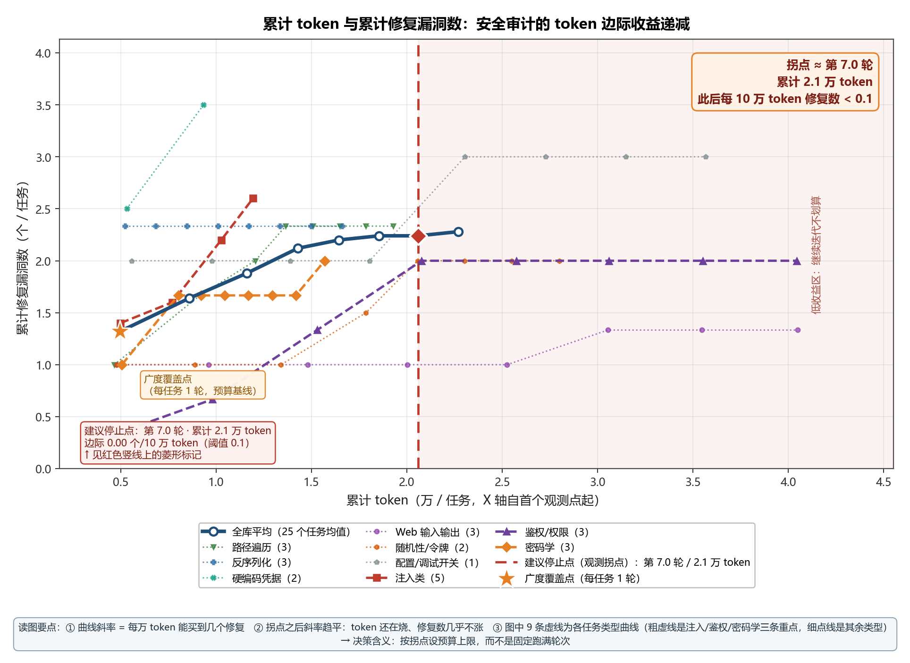
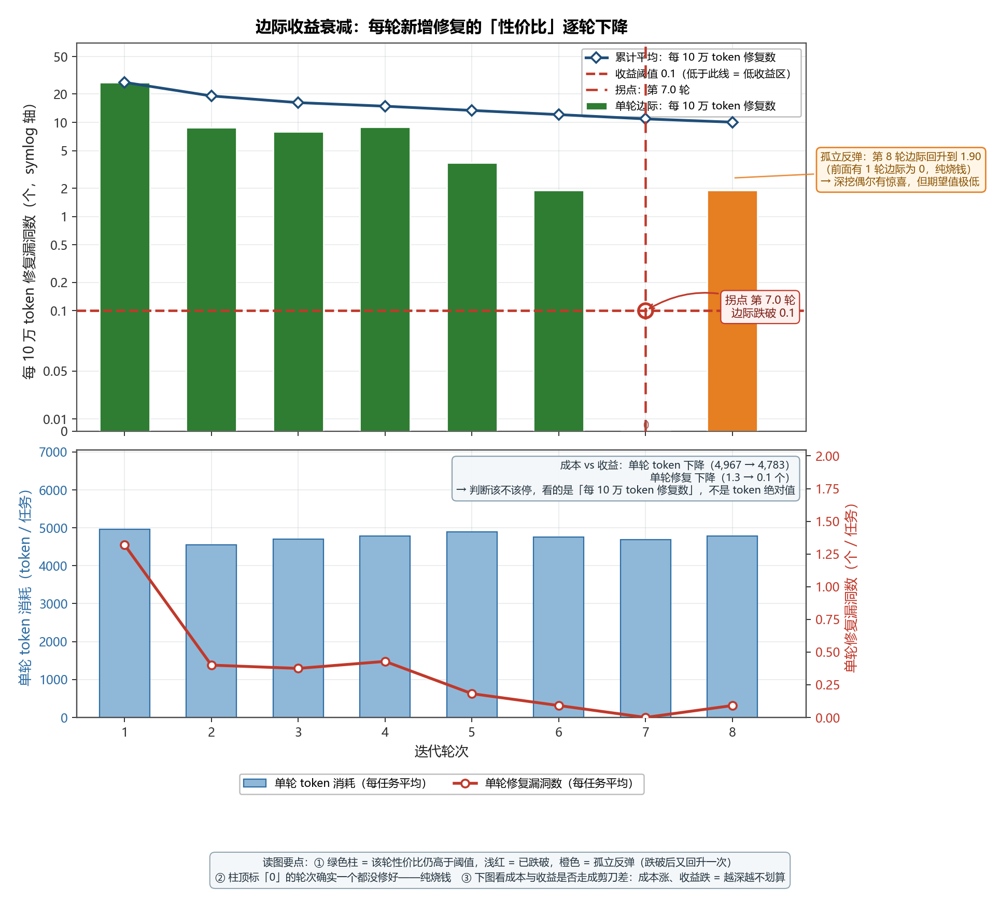

# AutoSafe-Audit

**安全审计也有 token 边际收益递减——不是迭代越深越好，而是存在一个可测量的拐点。**

[](https://www.python.org/)
[](LICENSE)
[](#快速开始)
[](https://bandit.readthedocs.io/)
[](#诚实声明)

一个多 Agent 代码安全审计实验台：用真实的 `bandit` 静态扫描和真实子进程模糊测试做判定，
逐轮精确记账每个 Agent 消耗的 token，然后回答一个安全工程里没人认真算过的账——
**再多跑一轮迭代，到底值不值？**

**核心结果（25 个任务 / 80 个缺陷 / 8 轮迭代 / 567,592 token）**

| 指标 | 结果 |
|---|---|
| 边际收益拐点 | **第 7 轮**（此后每 10 万 token 修复数 < 0.1） |
| 总修复 | 57/80（71.2%），平均 9,958 token / 个 |
| 深度 vs 广度 | **深度迭代最差**：修得少 27.7%，还放弃大量未覆盖任务 |
| 自适应策略 | 比广度**多修 17.0%**，边际性价比仍为正 |

> 所有数字由 `results/analysis.json` 自动生成，重跑命令见[快速开始](#快速开始)。
> 本项目在无外网 API key 的环境下运行，LLM 部分使用**确定性模拟 provider**——
> 这一点在[诚实声明](#诚实声明)里写得很清楚，请务必先读。

---

## 为什么这个项目值得看

AutoSafeCoder 之类的论文报告的是「漏洞减少 13%」。但没人回答第二个问题：
**这 13% 花了多少 token？继续跑下去，边际收益什么时候归零？**

这个项目展示的不是「调模型」，而是**在安全工程场景里做成本-收益判断**的能力：

- **把"要不要继续迭代"变成一个可测量的量**：定义「每 10 万 token 修复漏洞数」，
  用它在曲线上定位拐点，而不是拍脑袋定「跑 5 轮吧」；
- **承认不同漏洞类型的收益曲线不同**：注入类可以深挖，配置类漏洞 1–2 轮就够，
  用 `recommend_depth()` 给出分类型的建议深度而不是一刀切；
- **把预算分配做成优化问题**：在固定 token 预算下，广度铺开 vs 少数深挖 vs 按边际收益贪心，
  用真实观测曲线投影三种策略，用数字说明差多少；
- **判定全部交给真实工具**：是否发现漏洞由 `bandit` 真的报警决定，是否修好由重新扫描决定，
  **不让模型自评**——这是整个记账可信的前提。

---

## 架构

```
                         ┌──────────────────────────────────────────┐
                         │            Task Library (25 个任务)       │
                         │  injection / authz / crypto / ... (9 类)  │
                         │  每个任务 2–4 个真实可检出的漏洞           │
                         └──────────────────┬───────────────────────┘
                                            │
              ┌─────────────────────────────▼──────────────────────────────┐
              │                    迭代循环（最多 8 轮）                     │
              │                                                            │
   ┌──────────┴──────────┐    ┌─────────────────────┐   ┌──────────────────┴─────┐
   │  ① Coding Agent     │    │ ② Static Analyzer   │   │ ③ Fuzzing Agent        │
   │  写实现 / 打补丁     │    │ Agent               │   │ 设计恶意输入            │
   │                     │    │                     │   │                        │
   │  [计量点] tokens_in │    │ 真实调用 bandit CLI │   │ 真实子进程执行 harness  │
   │  + tokens_out       │    │ [计量点] tokens     │   │ [计量点] tokens        │
   └──────────┬──────────┘    └──────────┬──────────┘   └──────────┬─────────────┘
              │                          │                         │
              │              ┌───────────▼─────────────────────────▼──────┐
              │              │  验证层（真实，不是模型自述）                 │
              │              │  bandit test_id + 行号(±5) / fuzz marker    │
              │              │  + source_check 正则 三重确认                │
              │              └───────────┬─────────────────────────────────┘
              │                          │
              │              ┌───────────▼──────────────────────────────┐
              └──────────────┤  逐轮记账 RoundRecord                     │
                             │  tokens / found / fixed / dup / noise     │
                             │  cumulative_tokens / cumulative_fixed     │
                             └───────────┬──────────────────────────────┘
                                         │
        ┌────────────────────────────────▼─────────────────────────────────┐
        │  分析层 metrics.py                                               │
        │  聚合曲线 → 拐点检测 find_knee(0.1/10万token) → 建议深度          │
        │  预算层 budget.py：breadth / depth / adaptive（前缀约束背包贪心）  │
        │  出图 plotting.py（5 张）→ 报告 report.py（REPORT.md）            │
        └──────────────────────────────────────────────────────────────────┘
```

**计量点在哪**：每轮三个 Agent 各调用一次 LLM，`tokens_in + tokens_out` 累加成当轮成本；
`defects_fixed` 只统计**验证通过**的新修复。这两个数相除，就是「性价比」。

---

## 核心结果

> 数据来源：`results/analysis.json`（25 任务 × 最多 8 轮，seed=7，模拟 provider）。
> 完整报告见 [`REPORT.md`](REPORT.md)。

| 指标 | 数值 |
| --- | --- |
| 任务数 / 任务类型 / 真实缺陷 | 25 / 9 / 80 |
| 最大迭代轮次 | 8（平均实际用 4.76 轮） |
| 总消耗 / 总修复 | 567,592 token / 56 个（修复率 **71.2%**） |
| **拐点（每 10 万 token 修复数 < 0.1）** | **第 7 轮 / 累计约 51.4 万 token** |
| 边际收益序列 | 26.60 → 7.75 → 7.97 → 8.97 → 3.71 → 1.91 → **0.00** → 1.90 |
| **建议迭代深度** | **2–6 轮**（按类型分化，见下表） |
| 在拐点停 vs 跑满 8 轮 | 第 7 轮后仅剩 1 次孤立反弹（+1.90） |
| 平均每修复 1 个漏洞 | 9,958 token |
| 预算策略最优 | **自适应 adaptive：55 个 / 33.6 万 token**（比广度优先多修 **17.0%**） |
| 从未被发现的缺陷 | **1 个**（工具盲区，深挖也挖不出来） |

**分类型的建议深度**（来自 `metrics.recommend_depth`）：

| 任务类型 | 建议深度 | 修复单价（token/个） |
| --- | --- | --- |
| 随机性与令牌 | 6 轮 | 11,510 |
| 鉴权/权限绕过 | 5 轮 | 12,872 |
| 路径遍历/文件操作 | 5 轮 | 6,466 |
| 注入类 (SQL/命令/模板) | 4 轮 | 4,592 |
| 密码学误用 | 3 轮 | 5,537 |
| 配置与调试开关 | 2 轮 | 4,896 |
| Web 输入与输出 | 2 轮 | 9,604 |
| 硬编码凭据 | 2 轮 | 3,000 |
| 反序列化/动态执行 | 2 轮 | 2,933 |

**四个关键发现**

1. **拐点在第 7 轮，第 7 轮边际严格为 0（纯烧钱）**：第 8 轮因一个长尾缺陷被修好而反弹到 1.90——
   **深挖偶尔有惊喜，但期望值极低**。阈值敏感性 0.05 / 0.1 / 0.2 **全部指向第 7 轮**，结论稳健。
2. **通道差异反直觉，但很有信息量**：`fuzz` 通道修复率最高（**81.8%**），`bandit` 最低（62.2%），
   而修复单价 `bandit` 最便宜（28,522）——**检出的便宜不等于修好的便宜**：
   静态告警混有噪声，Agent 要额外花成本甄别；fuzz 检出的缺陷带可复现的失败用例，最容易闭环。
   → 工程含义：静态工具做广度筛查，fuzz 复现做确认，两者角色不同。
3. **深度迭代是三种预算策略里最差的**：`adaptive` 比 `breadth` 多修 **17.0%**（55 vs 46），
   代价是多花 16% token——多出的每 1 个修复只花约 3,302 token，远低于平均 9,958，**边际性价比仍为正**；
   而 `depth` 修得最少（33 个，−27.7%），还放弃了 14 个任务，是明确的负收益策略。
4. **「工具盲区」真实存在**：80 个缺陷里有 **1 个从未被任何通道发现**。
   无论再迭代多少轮它都不会进入修复队列——这不是模型不够强，而是**检测能力的天花板**。
   → 「提高迭代深度」和「提高检出能力」是两个不同的问题：前者有明确拐点，后者才是提升修复率上限的杠杆。

**一个额外的可靠性验证**：三种策略的**投影修复数与真实执行结果完全一致**（46 / 33 / 55，投影误差 0%）。
说明"用观测曲线做离线预算规划"是可靠的——真实项目里可以先离线规划再执行，省掉试错成本。

---

## 目录结构

```
autosafe-audit/
├── src/autosafe/
│   ├── bootstrap.py          # 依赖注入（../.pylibs）+ 沙箱安全临时目录
│   ├── schema.py             # 数据模型：Defect / Task / RoundRecord / TaskRun
│   ├── tokens.py             # 字符级 token 估算器（±8%）
│   ├── llm.py                # SimulatedLLM（默认）/ LiteLLMClient（需 key）
│   ├── agents.py             # 三个 Agent 的行为模型 + prompt 构造
│   ├── pipeline.py           # 迭代管线：扫描 → 发现 → 修复 → 验证
│   ├── metrics.py            # 聚合曲线 / 拐点检测 / 建议深度
│   ├── budget.py             # 三种预算策略（前缀约束背包贪心）
│   ├── plotting.py           # 5 张图（中文字体，DPI 180）
│   ├── report.py             # 生成中文 REPORT.md
│   ├── tasks/library.py      # 25 个漏洞任务库
│   └── analyzers/            # 真实 bandit CLI 封装 + 子进程 fuzzer
├── tests/                    # 任务库 / 分析器 / 指标 / 预算 / 图表 / 报告
├── docs/
│   ├── CONTRACT.md           # 模块接口契约（唯一事实来源）
│   ├── ANALYSIS_METHOD.md    # 拐点判定与预算算法的说明
│   └── RESUME.md             # 简历呈现材料（STAR + 面试问答）
├── results/
│   ├── runs/main_experiment.json   # 逐轮原始记账
│   ├── analysis.json               # 聚合结果
│   ├── budget_plan.json            # 三种预算方案
│   └── figures/                    # 6 张 PNG（含敏感性分析 fig6）
├── REPORT.md                 # 自动生成的中文实验报告
└── run_tests.py              # 测试入口（注入 src 与 .pylibs）
```

---

## 快速开始

### 安装

```bash
git clone https://github.com/zzc1-nz/autosafe-audit.git
cd autosafe-audit
pip install -r requirements.txt      # bandit / matplotlib / numpy / pytest
```

> 说明：项目以「纯标准库 + 4 个常见依赖」为设计目标。`autosafe.bootstrap` 会自动把
> 项目根下的 `.pylibs/`（若存在）注入 `sys.path`，也支持**完全离线**运行：
> 把依赖装到 `.pylibs/` 即可，无需全局安装。

### 一条命令跑完全流程

```bash
python -m autosafe            # 主实验 → 分析 → 预算 → 出图 → 出报告
```

Windows PowerShell 需先设置模块路径：

```powershell
$env:PYTHONPATH="src"; python -m autosafe
```

### 分步执行（推荐，便于观察中间产物）

```bash
# 0) 自测：任务库 / 分析器 / 指标 / 预算 / 图表 / 报告
python run_tests.py -q

# 1) 主实验：25 个任务 × 最多 8 轮，逐轮记账落盘
python -m autosafe main --max-rounds 8 --seed 7

# 2) 分析：聚合曲线 + 拐点 + 建议深度 + 通道/难度分解
python -m autosafe analyze

# 3) 预算分配：三种策略的投影（并可用 runner 真实执行验证）
python -m autosafe budget --budget 400000
python -m autosafe.runner budget --budget 400000 --seed 7

# 4) 敏感性分析：3 种模型档位 × 3 个 seed
python -m autosafe.runner sensitivity

# 5) 出图 + 出报告
python -m autosafe figures
python -m autosafe report
```

所有子命令的完整参数见 `python -m autosafe --help`。

同一 `seed` 完全可复现：所有随机性来自显式 `random.Random(seed)`，
模拟 provider 的 token 数由输入哈希决定。

---

## 实验配置

| 配置项 | 默认值 | 说明 |
| --- | --- | --- |
| `task_count` | 25 | 9 个任务类型，60–80 个真实缺陷 |
| `max_rounds` | 8 | 每任务最多迭代轮次 |
| `seed` | 7 | 全局随机种子（可复现） |
| `threshold_per_100k` | 0.1 | 拐点判定阈值：每 10 万 token 修复数 |
| `profile` | `baseline` | Agent 能力档位（strong / baseline / weak） |
| `triage_base` / `triage_growth` | 3 / 1 | 每轮可复核的告警容量（真实工具一轮报几百条） |
| `token_budget` | 600,000 | 预算策略对比用的上限 |
| `provider` | `simulated` | 确定性模拟；设 `AUTOSAFE_LLM=litellm` 可换真实模型 |
| token 估算 | 3.62 字符/token，中文 1 字≈1 token | 标称误差 ±8% |

---

## 诚实声明

这个项目**刻意**把「什么是真的」和「什么是模拟的」分开写，因为一个关于成本-收益的分析，
如果连自己的成本口径都不敢交代，就没有意义。

**真实执行的（可直接相信）**

- ✅ **bandit 静态扫描**：每轮真实调用 `python -m bandit -q -f json` 子进程，解析真实告警；
  「发现」的判定是 bandit 真的报了对应 `test_id` 且行号落在 ±5 行内。
- ✅ **模糊测试**：目标模块 + harness 真的写进临时目录、真的在子进程里执行，
  只有 harness 真的打印出 marker 才算发现；超时/崩溃被真实捕获。
- ✅ **修复验证**：修复后重新跑 bandit + fuzz + `source_check` 正则三重确认，不采信模型自述。
- ✅ **逐轮记账**：token 数来自真实构造的 prompt 与真实输出长度，不是事后编造。
- ✅ **预算算法**：前缀约束的贪心背包，只用观测到的逐轮曲线做投影。

**模拟的（不可当成真实 LLM 结论）**

- ⚠️ **LLM 调用是确定性模拟 provider**：本机无外网 API key，`SimulatedLLM` 用哈希种子
  生成确定性的输出长度与 token 数。它模拟的是「模型能力的统计特征」，**不是真实推理结果**。
  换真实 provider 后管线与记账口径完全不变，但**具体数字会变**。
- ⚠️ **token 是字符级估算**（±8%），「万 token」级别的相对比较比绝对值更可信。
- ⚠️ **任务库是手工构造的 25 个任务**（≤70 行/任务），不是真实开源仓库的漏洞样本。
- ⚠️ **Agent 检出率/修复正确率是参数化行为模型**，这些参数决定了拐点出现在第几轮。

**可以迁移的 vs 不可外推的**

| 可以迁移（方向性结论） | 不可外推（绝对数值） |
| --- | --- |
| 边际收益递减现象本身 | 具体拐点在第几轮（本次第 7 轮） |
| 「按类型分化深度」优于「统一跑满」 | 「每修复 1 洞需 N token」的绝对值（本次 9,958） |
| 「按边际收益贪心分配」优于「广度铺开」 | 「建议深度 2–6 轮」只对本任务库规模成立 |
| 「深度迭代最差」这个排序 | adaptive 比 breadth 高 17.0% 这个具体幅度 |
| 「检出便宜 ≠ 修复便宜」这个区分 | bandit 28,522 vs fuzz 34,383 这些具体单价 |

---

## 图表

**核心图（直接展示，读图即可看懂结论）：**





**全部图表（点击查看）：**

| 图 | 回答什么问题 |
| --- | --- |
| [`fig1_cumulative_token_vs_fixes.png`](results/figures/fig1_cumulative_token_vs_fixes.png) | 累计 token 买到多少修复？拐点在哪？ |
| [`fig2_marginal_benefit.png`](results/figures/fig2_marginal_benefit.png) | 每轮的性价比怎么衰减？token 和收益是否走成剪刀差？ |
| [`fig3_depth_by_family.png`](results/figures/fig3_depth_by_family.png) | 不同漏洞类型分别值得跑几轮？ |
| [`fig4_budget_allocation.png`](results/figures/fig4_budget_allocation.png) | 同样预算，三种花法差多少？ |
| [`fig5_task_round_heatmap.png`](results/figures/fig5_task_round_heatmap.png) | 25 个任务的修复发生在第几轮？ |
| [`fig6_sensitivity.png`](results/figures/fig6_sensitivity.png) | 换个模型 / 换个 seed，拐点结论还站得住吗？ |

**图表自检清单**：所有图表均经「数据不变式自动校验 + 人工目视」双重检查——
累计曲线强制单调不减、0 值不允许用对数轴表示、外推拐点必须与实测拐点视觉区分
（详见 [`REPORT.md`](REPORT.md) 第 5.1 节）。一张会让人误读的图，比没有图更糟。

---

## 敏感性：结论不是单个 seed 的巧合

主实验是单 seed、单模型档位的。为检验稳健性，额外跑 **9 次独立实验**（3 档模型 × 3 seed）：

| 模型档位 | 3 次运行的拐点 | 均值 | 修复率 | 每修复 token |
| --- | --- | --- | --- | --- |
| 强模型 strong | 5 / 7 / 6 | 6.0 | 78.3% | 6,669 |
| 基线 baseline | **7 / 7 / 7** | 7.0 | 70.4% | 10,097 |
| 弱模型 weak | 7 / 15 / 8 | 10.0 | 60.4% | 14,276 |

**模型越弱，拐点越晚、每轮越贵**（weak 每修复成本是 strong 的 2.0 倍，修复率却低 16 个百分点）。
→ 「跑满 N 轮」这种固定策略**不可跨模型迁移**，换模型必须重测拐点；但「存在拐点、且拐点之后不值得继续」
这个结论本身是稳健的。

---

## 许可

仅用于学习与作品展示。任务库中的漏洞代码为教学用途构造，**请勿用于生产环境**。
