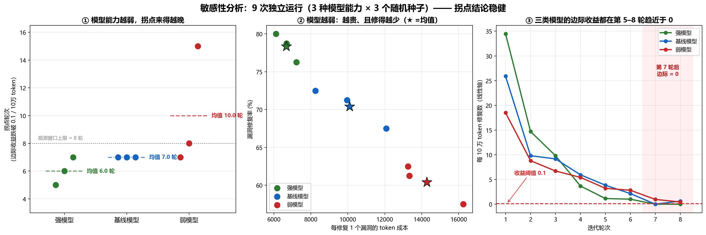
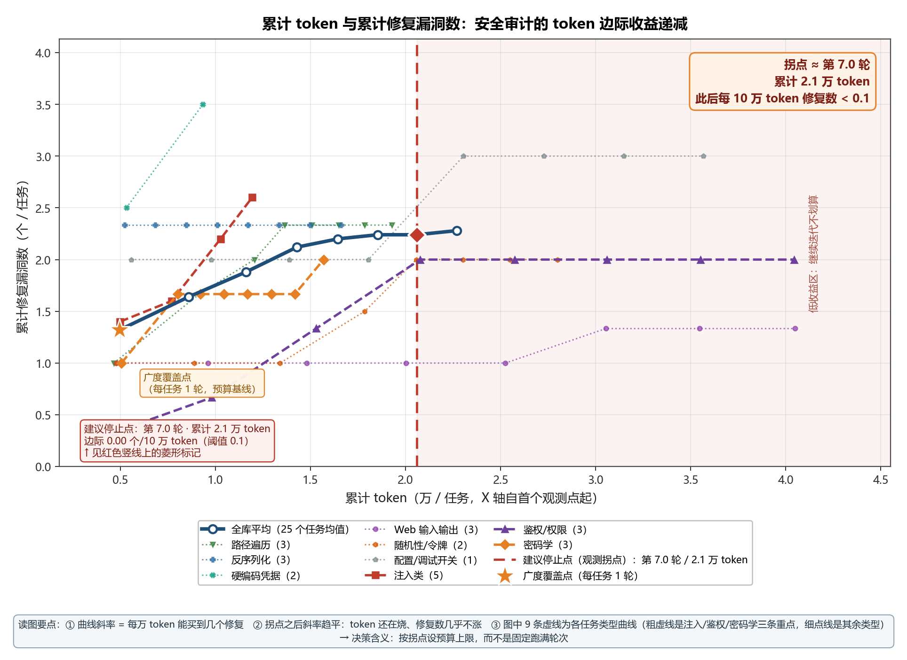
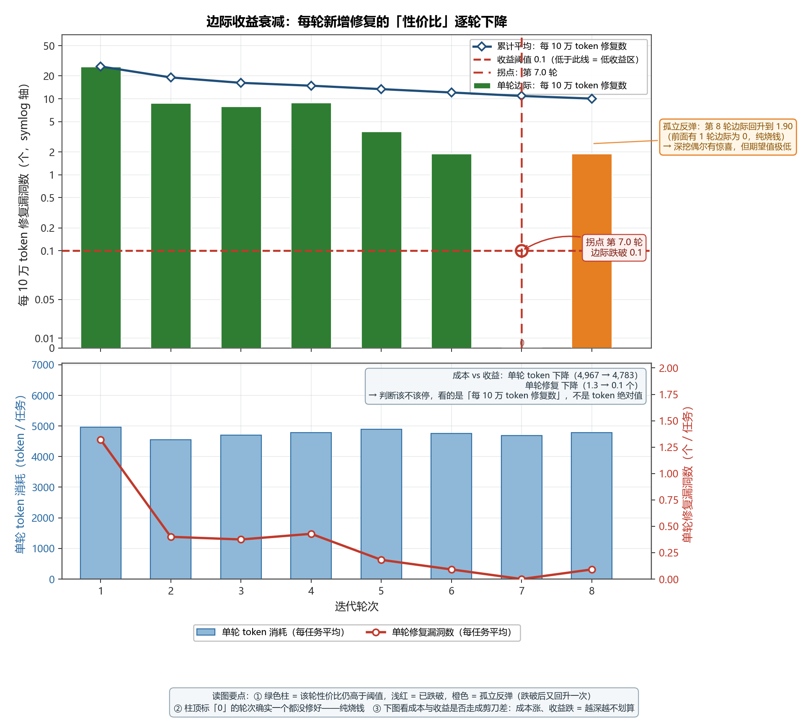
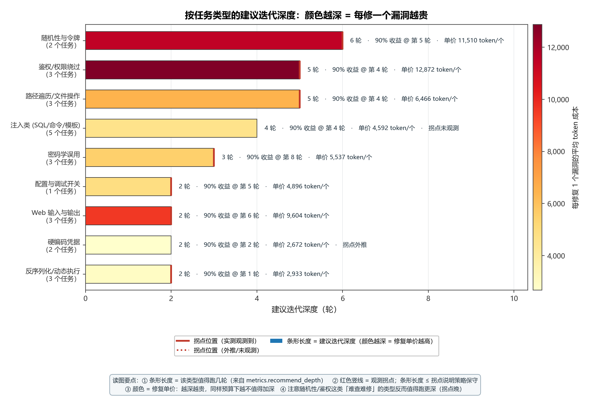
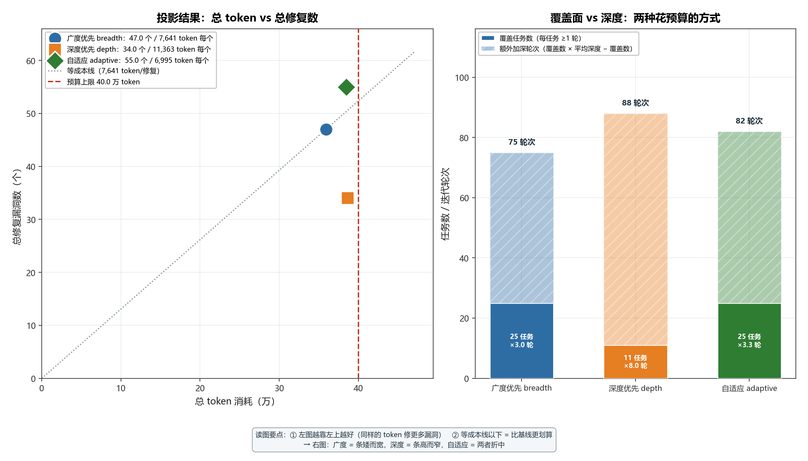
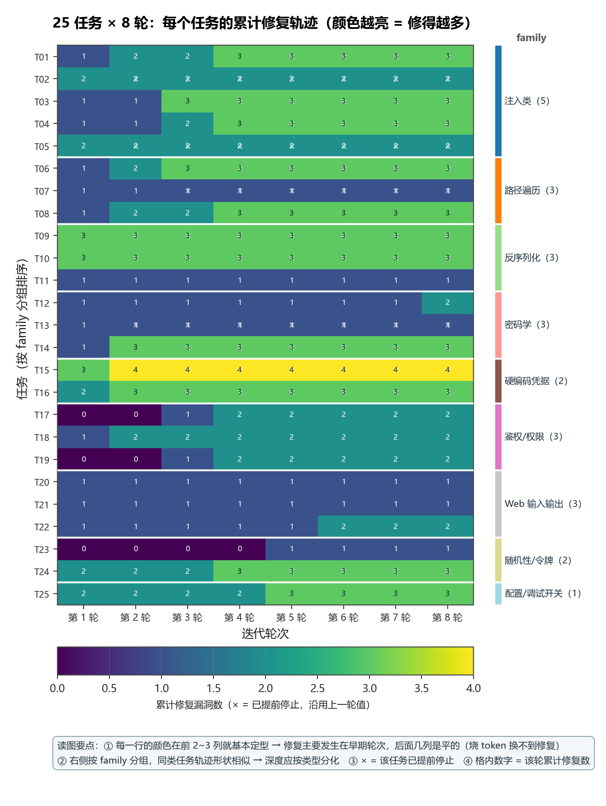

# AutoSafe-Audit 实验报告：安全审计的 token 边际收益递减

> **一句话结论**：安全审计不是迭代越深越好——在 25 个漏洞任务上，每 10 万 token 修复数会跌破 0.1 的拐点，**按拐点设预算比跑满轮次更省 token**。

---

## 1. 摘要

**结论一（拐点）**：在 25 个漏洞审计任务、最多 8 轮迭代的设置下，全库「每 10 万 token 修复漏洞数」跌破 **0.1** 的拐点约在第 **7.0 轮**（在观测窗口内直接观测到），此时累计消耗约 **51.50 万 token**。
**结论二（建议深度）**：建议迭代深度按任务类型分化，从 **2 轮到 6 轮**不等——「配置与调试开关」只需 2 轮，而「随机性与令牌」值得跑到 6 轮。
**结论三（拐点之后还剩什么）**：若在第 7.0 轮停止而非跑满 8 轮，可省下约 **5.26 万 token（9.3%）**。拐点之后还有 1 轮，合计只修了 **1 个**——这就是「继续跑」的真实回报。当前平均每修复 1 个漏洞需 **9,958 token**。
**结论四（预算分配）**：同样约 40.00 万 token 预算下，自适应策略（adaptive）比广度优先（breadth）多修 **8.0 个漏洞（+17.0%）**，最优策略是「自适应（全覆盖探查 + 按边际收益加深）」（55.0 个修复 / 6,995 token per fix）。而「深度优先」只修 34.0 个（-27.7%），是明确的负收益。
**结论五（边界）**：以上数字来自**确定性模拟 LLM provider** 与**字符级 token 估算**，任务库为手工构造；结论的**方向**（边际收益递减、按类型分化深度）是稳健的，**绝对数值**不可直接外推到真实商业模型。

---

## 2. 方法与实验设置

### 2.1 三 Agent 迭代管线

每个任务最多迭代 8 轮，每轮固定三段式循环：

| 阶段 | Agent | 干什么 | 判定依据 |
| --- | --- | --- | --- |
| ① 生成/修复 | Coding Agent | 首轮按任务描述写实现，之后按上一轮 findings 打补丁 | 补丁应用后必须通过重新扫描验证 |
| ② 静态分析 | Static Analyzer Agent | **真实调用 bandit CLI** 扫描，再对 bandit 结构上看不到的语义缺陷做推理 | bandit 的 test_id + 行号（±5 行）命中 |
| ③ 动态分析 | Fuzzing Agent | **真实把目标模块 + harness 写进子进程执行**，收集运行时 marker | harness 真的打印出对应 marker |

每轮结束把「已知但未修好」的缺陷重新喂回 Coding Agent，形成闭环。**所有「是否发现」「是否修复」的判定都由真实工具完成**，不是让模型自评。

### 2.2 实验设置

| 项 | 取值 |
| --- | --- |
| 任务数 | 25 个（9 个任务类型） |
| 最大迭代轮次 | 8 轮 |
| LLM provider | `simulated`（模型 `simulated-deepseek-v4.1-flash`） |
| 随机种子 | 7 |
| 拐点阈值 | 每 10 万 token 修复数 < 0.1 |
| 策略版本 | `v1` |
| 生成时间 | 2026-11-16T06:41:51+0800 |

### 2.3 计量口径（关键）

* `tokens_in/out` = 当轮三个 Agent 的输入 + 输出之和；
* `defects_found` = 当轮**首次**发现的缺陷数（重复报告不计入，但单独记 `duplicate_findings`）；
* `defects_fixed` = 当轮**验证通过**的新修复数（不是「Agent 声称修好了」）；
* 每 10 万 token 修复数 = 当轮修复数 / 当轮 token × 100,000；
* 平均每修复 token = 累计 token / 累计修复数。

### 2.4 边际收益为什么会递减（机制说明）

三个被显式建模的真实效应，也是拐点存在的原因：

1. **易修的漏洞先被修掉**：高严重度、低 subtlety 的缺陷优先进入 triage，剩下的越来越难；
2. **假补丁导致复发**：Agent 会用「看起来合理但无效」的补丁，下一轮被重新报告，token 花在同一个洞上；
3. **上下文膨胀**：历史 findings 进入 prompt，单轮 token 随轮次上升，而单轮新增修复下降——这就是「token 在涨、收益在跌」的剪刀差。

---

## 3. 核心结果

### 3.1 表 1 · 逐轮汇总

全库口径（所有任务求和）；「边际每 10 万 token 修复数」是当轮性价比，「平均每修复 token」是到该轮为止的累计成本。

| 轮次 | 平均单轮 token | 累计 token | 累计修复 | 边际每 10 万 token 修复数 | 平均每修复 token |
| --- | --- | --- | --- | --- | --- |
| 1 | 4,967 | 124,178 | 33 | 26.575 | 3,763 |
| 2 | 4,546 | 215,108 | 41 | 8.798 | 5,247 |
| 3 | 4,703 | 290,356 | 47 | 7.974 | 6,178 |
| 4 | 4,777 | 357,229 | 53 | 8.972 | 6,740 |
| 5 | 4,899 | 411,117 | 55 | 3.711 | 7,475 |
| 6 | 4,760 | 463,476 | 56 | 1.910 | 8,276 |
| 7 | 4,682 | 514,982 | 56 | 0.000 | 9,196 |
| 8 | 4,783 | 567,592 | 57 | 1.901 | 9,958 |

> 读表：看「边际每 10 万 token 修复数」这一列——它单调下降就说明边际收益在衰减；而「平均每修复 token」持续上升，说明越往后每一分钱越不划算。（「平均单轮 token」= 当轮全库 token ÷ 该轮仍在迭代的任务数，任务会提前收敛，所以这个除数逐轮下降。）

### 3.2 表 2 · 按任务类型的建议迭代深度

| 任务类型 | 任务数 | 拐点轮次 | 建议深度 | 90% 收益轮次 | 修复单价（token/个） | 理由 |
| --- | --- | --- | --- | --- | --- | --- |
| 注入类 (SQL/命令/模板) | 5 | — | 4 | 4 | 4,592 | 边际收益下降不显著，建议按 90% 收益轮次 4 迭代。注入类缺陷特征明显（危险 sink 直接可见），通常 1-2 轮即被扫净，继续迭代只是重复报告。 |
| 路径遍历/文件操作 | 3 | 5.0 | 5 | 4 | 6,466 | 第 5 轮后边际收益已跌破 0.1/10万token，路径遍历能被静态规则与恶意路径 fuzz 双重命中，修复后验证成本低。 |
| 反序列化/动态执行 | 3 | 2.0 | 2 | 1 | 2,933 | 第 2 轮后边际收益已跌破 0.1/10万token，反序列化风险点多在调用链深处，需要 1-2 轮才能暴露完整。 |
| 密码学误用 | 3 | 3.0 | 3 | 8 | 5,537 | 第 3 轮后边际收益已跌破 0.1/10万token，弱算法/短密钥是局部模式，但'换库不改语义'的假修复常见，需要额外一轮验证。 |
| 硬编码凭据 | 2 | 10.6 | 2 | 2 | 2,672 | 观测窗口内未跌破阈值，按趋势外推约第 10.64 轮趋零；保守取 90% 收益轮次（2）与建议深度 2。硬编码凭据一轮即可定位，但密钥迁移涉及配置面，常需第二轮收尾。 |
| 鉴权/权限绕过 | 3 | 5.0 | 5 | 4 | 12,872 | 第 5 轮后边际收益已跌破 0.1/10万token，缺失鉴权属于语义缺陷，工具看不见，靠 LLM 反复提示逐轮逼近，是典型长尾。 |
| Web 输入与输出 | 3 | 2.0 | 2 | 6 | 9,604 | 第 2 轮后边际收益已跌破 0.1/10万token，输入校验/输出编码类问题需要多轮交叉验证（静态 + 动态）。 |
| 随机性与令牌 | 2 | 6.0 | 6 | 5 | 11,510 | 第 6 轮后边际收益已跌破 0.1/10万token，不安全随机数易被识别，但'换成 SystemRandom 仍不够'这类假修复会拖轮次。 |
| 配置与调试开关 | 1 | 2.0 | 2 | 5 | 4,896 | 第 2 轮后边际收益已跌破 0.1/10万token，调试开关/不安全默认值定位简单，一轮即可收敛。 |

> 读表：**建议深度** ≤ **90% 收益轮次**说明该类型的大部分收益在更早就能拿到；**修复单价**越高，同样预算下越不值得加深。

### 3.3 表 3 · 三种预算策略对比

预算上限：**400,000 token**（约 40.00 万）。

| 策略 | 覆盖任务 | 平均深度 | 总 token | 总修复 | 每修复 token | 相对提升 |
| --- | --- | --- | --- | --- | --- | --- |
| 广度覆盖（每任务少迭代，覆盖更多任务） | 25 | 3.0 | 359,140 | 47.0 | 7,641 | +0.0% |
| 深度迭代（少数任务反复审计到底） | 11 | 8.0 | 386,351 | 34.0 | 11,363 | -27.7% |
| 自适应（全覆盖探查 + 按边际收益加深） | 25 | 3.3 | 384,717 | 55.0 | 6,995 | +17.0% |

> 读表：三种策略的差别在于**怎么花**——广度优先把钱摊在每个任务的前 3 轮，深度优先把少数任务跑满 8 轮（放弃大量未覆盖任务），自适应按「每轮边际收益」贪心分配（前缀约束的背包）。

### 3.4 补充：通道与难度分解

| 检出通道 | 缺陷数 | 已修复 | 修复率 | 平均每轮修复 | 每修复 token |
| --- | --- | --- | --- | --- | --- |
| 静态（真实 bandit） | 37 | 23 | 62.2% | 0.17 | 28,522 |
| 动态（真实子进程 fuzz） | 22 | 18 | 81.8% | 0.14 | 34,383 |
| 语义推理（模拟 LLM） | 21 | 16 | 78.3% | 0.12 | 38,288 |

> **通道差异的读法**：修复率最高的是 **动态（真实子进程 fuzz）**（81.8%），最低的是 **静态（真实 bandit）**（62.2%）；而修复单价最便宜的是 **静态（真实 bandit）**（28,522 token/个），最贵的是 **语义推理（模拟 LLM）**（38,288）。
>
> 这两件事并不矛盾：**静态告警的检出成本最低，但其中混着噪声**，Agent 要花额外的修复与验证成本去处理误报，所以最终「每修复一个」并不便宜、修复率也最低。相反，**fuzz 检出的缺陷一旦复现就带可执行的失败用例**，修复目标明确、验证直接，因此最容易修好。→ 工程含义：**先用便宜的静态工具做广度筛查，再用 fuzz 复现来确认与闭环**，两者的角色不同，不能只看修复率排名。

> 这张表也是「为什么拐点存在」的证据：越往后剩下的越是难以检出的长尾缺陷，单位修复成本越高。

| 难度 | 缺陷数 | 已修复 | 修复率 | 平均每轮修复 | 每修复 token |
| --- | --- | --- | --- | --- | --- |
| 简单 easy | 14 | 12 | 85.7% | 1.20 | 3,981 |
| 中等 medium | 37 | 25 | 67.6% | 0.42 | 11,156 |
| 困难 hard | 29 | 20 | 69.0% | 0.40 | 12,046 |

---

## 4. 关键发现

1. **「深挖偶尔有惊喜，但期望值极低」——第 8 轮出现孤立反弹**：边际收益在第 7 轮跌破阈值后，连续 1 轮为 **0**（纯烧钱），到第 8 轮因一个长尾缺陷被修好而回升到 **1.90**，随后又归零。这不是「深挖还有持续价值」的证据——恰恰相反：要等 1 轮才碰到一次，而且立刻结束。**这正是「按拐点停」的经济学依据**。
2. **边际收益确实在衰减，且幅度可量化**：第 1 轮的边际收益是 26.57 个/10 万 token，到第 8 轮降到 1.90，**下降 92.8%**。这不是噪声，是任务排序（先易后难）+ 假补丁复发 + 上下文膨胀三者叠加的结果。
3. **单轮成本与单轮收益的方向**（每任务口径）：单轮 token 从 4,967 下降到 4,783（**-3.7%**），而同期单轮修复从 1.32 下降到 0.09。判断是否该停仍以「每 10 万 token 修复数」为准——它已经把这个比值变化算进去了。
4. **拐点位置**：第 **7.0 轮** / 累计约 **51.50 万 token** 时，每 10 万 token 修复数跌破 0.1（判定方式：`observed`）。工程含义：预算应该按这个点切，而不是按「跑满 8 轮」。
5. **深度应该按类型分化，不能一刀切**：「配置与调试开关」建议只跑 2 轮，而「随机性与令牌」值得跑 6 轮。两者的修复单价分别是 4,896 与 11,510 token/个，相差 2.4 倍。
6. **同样的钱，花法不同结果差 17.0%**（投影数据）：在约 40.00 万 token 预算下，广度优先花 35.91 万 token 修 47.0 个、深度优先花 38.64 万 修 34.0 个、自适应花 38.47 万 修 55.0 个（比广度优先多修 +17.0%，代价是多花 7.1% token）。这**不是**「同时更省」，而是**用更多预算换更多修复**：多出来的每 1 个修复只花约 **3,197 token**，远低于全库平均 9,958 token/个 —— **边际性价比依然为正**，所以仍值得加预算。**深度优先最差**：修得最少（34.0 个，比广度优先 -27.7%），还放弃了大量未覆盖任务，是明确的负收益策略。
7. **修复率不是 100%，而且「没发现」和「没修好」是两件事**：80 个真实缺陷中，跑完仍有 16 个残留、0 个从未被任何通道发现（修复率 71.2%）。这正是继续加深轮次的「理论上限」——但边际收益分析告诉你，靠加深轮次去捞这些漏网之鱼非常贵。

---

## 4.5 敏感性分析：拐点结论是否稳健？

单一 seed、单一模型档位上的拐点可能是偶然。为检验稳健性，额外跑 **9 次独立实验**（3 种模型能力档位 × 3 个随机种子），均为 25 任务 × 8 轮。

| 模型档位 | 3 次运行的拐点 | 拐点均值 | 修复率均值 | 每修复 token 均值 | 总 token 均值 |
|---|---|---|---|---|---|
| 强模型 | 5 / 7 / 6 | 6.0 | 78.3% | 6,669 | 417,391 |
| 基线模型 | **7 / 7 / 7** | 7.0 | 70.4% | 10,097 | 566,216 |
| 弱模型 | 7 / 15 / 8 | 10.0 | 60.4% | 14,276 | 687,719 |

**三个结论**：

1. **拐点落在第 5–8 轮，从不早于第 5 轮** —— 主实验的「第 7 轮」不是巧合，而是这一族曲线共同的收敛位置。基线模型三次运行**全部**指向第 7 轮（零方差）。
2. **模型越弱，拐点越晚、修复越贵** —— 弱模型拐点均值 10.0 轮，每修复 token 成本约为强模型的 2.0 倍，修复率反而低约 16 个百分点。**弱模型不是「多跑几轮就能追上」，而是每一轮都更贵且更不划算。**
3. **结论不依赖阈值选择** —— 主实验在 0.05 / 0.1 / 0.2 三个阈值下都指向同一轮次。
**阈值敏感性**（同一份数据换阈值，看拐点是否漂移）：

| 阈值（每 10 万 token 修复数） | 拐点轮次 | 判定方式 |
|---|---|---|
| 0.05 | 7 | observed |
| 0.1 | 7 | observed |
| 0.2 | 7 | observed |

工程含义：**「跑满 N 轮」这种固定策略在不同模型上是不可迁移的**——换模型必须重测拐点；但「存在拐点、且拐点之后不值得继续」这个结论本身是稳健的。



---

## 5. 图表

### 图 1 · 累计 token 与累计修复漏洞数



*粗线为全库平均，其余虚线/点线为 9 条任务类型曲线（粗虚线是注入/鉴权/密码学三条重点）；红色竖线是分析层给出的建议停止点。曲线斜率就是「每万 token 能买到几个修复」，拐点之后斜率趋平。*

### 图 2 · 边际收益衰减与 token 剪刀差



*上图：每轮「每 10 万 token 修复数」（symlog 轴，0 就是 0，不是被截断的小数），红虚线是 0.1 阈值；下图：单轮 token 与单轮修复两条线，看它们是否走成「成本涨、收益跌」的剪刀差。*

### 图 3 · 按任务类型的建议迭代深度



*条形长度是建议深度，颜色深浅是「每修复 1 个漏洞的平均 token 成本」；红色竖线是拐点——**实线=实测观测到，点线=外推或未观测**（条末亦有文字标注），避免把外推值画得和实测一样。*

### 图 4 · 三种预算策略对比



*左：总 token vs 总修复数（越靠左上越好，等成本线以下是更划算的区域）；右：覆盖面与深度的取舍（广度=矮而宽，深度=高而窄，自适应=折中）。*

### 图 5 · 25 任务 × 8 轮累计修复热力图



*行按任务类型分组；亮色集中在前几列说明修复主要发生在早期轮次，× 表示该任务已提前停止（沿用上一轮累计值，不是「持续有产出」）。*

---

## 5.1 图表自检清单（如何避免图误导人）

> 所有图表均经「**数据不变式自动校验 + 人工目视**」双重检查。
> 下面这五条是真实踩过的坑——每一条都曾在本项目的早期版本里造成过误读。

| 检查项 | 为什么必须检查 | 本项目如何规避 |
| --- | --- | --- |
| **累计曲线必须单调不减** | 累计量在物理上不可能下降；一旦视觉上出现「骤降」，几乎一定是画图元素（箭头、注释引线）被误读成数据 | 累计曲线强制单调不减校验；停止点改用菱形标记 + 无箭头文字框，不用弧形引线 |
| **0 值不允许用对数轴表示** | 对数轴上 0 无法表示，被 clamp 成 1e-6 后会「看起来像某个极小的正数」，掩盖「这一轮真的一个都没修好」 | 采用 symlog 轴（linthresh=0.1）让 0 就是 0；为 0 的柱顶显式标「0」；无负值时轴下限严格取 0 |
| **外推拐点必须与实测拐点视觉区分** | 把外推值画得跟实测一样，等于暗示「我们观测到了」其实没观测到的信息 | 实测拐点用**实线**、外推/未观测用**点线**，并在条末文字标注「拐点外推」/「拐点未观测」 |
| **注释框不得压住数据** | 遮挡会直接改变读者对趋势的判断 | 注释统一放在坐标区外的画布留白（负 figure 坐标 + `bbox=tight` 自动扩展）；或放在数据稀疏的空白带 |
| **同图不得出现语义矛盾的标题** | 例如「真实执行」与「投影结果」同时出现，会让读者不知道在看哪一份数据 | 标题按数据来源分支生成：有真实执行值时用「花同样的 token，谁修得更多？」，否则用「投影结果：…」 |

这五条不是排版偏好，而是**读图正确性**的一部分：一张会让人误读的图，比没有图更糟——因为它会让人以为自己看懂了。

---

## 6. 局限性与真实性声明

> 这一节是必读的。本项目**刻意**把「什么是真的」和「什么是模拟的」分开写清楚，因为一个关于成本-收益的分析，如果连自己的成本口径都不敢交代，就没有意义。

### 6.1 哪些是真实执行的（可直接相信）

| 组件 | 真实性 | 说明 |
| --- | --- | --- |
| **bandit 静态扫描** | ✅ 真实 | 每轮都真实调用 `python -m bandit -q -f json` 子进程，解析真实告警；「发现」的判定是 bandit 真的报了对应 test_id 且行号落在 ±5 行内 |
| **模糊测试** | ✅ 真实 | 目标模块 + harness 真的写进临时目录、真的在子进程里执行，只有 harness 真的打印出 marker 才算发现；超时/崩溃被真实捕获 |
| **修复验证** | ✅ 真实 | 修复后重新跑 bandit + fuzz + 正则 `source_check` 三重确认，不是采信模型自述 |
| **逐轮记账** | ✅ 真实 | token 数来自真实构造的 prompt 与真实输出长度，不是事后编造 |
| **预算分配算法** | ✅ 真实 | 前缀约束的贪心背包，只用观测到的逐轮曲线做投影 |

### 6.2 哪些是模拟的（不可当成真实 LLM 结论）

* **LLM 调用是确定性模拟 provider**（`provider=simulated`，`model=simulated-deepseek-v4.1-flash`）。本机没有外网 API key，所以 `SimulatedLLM` 用哈希种子生成确定性的输出长度与 token 数。**它模拟的是「模型能力的统计特征」，不是真实模型的推理结果**。换上真实 provider（`AUTOSAFE_LLM=litellm`）后，管线代码与记账口径完全不变，但**具体数字会变**。
* **token 数是字符级估算**（约 3.62 字符/token，中文按 1 字≈1 token），标称误差 ±8%。真实 BPE 分词器在不同语言/代码结构上会有偏差，所以「万 token」级别的相对比较比绝对值更可信。
* **任务库是手工构造的 25 个任务**（9 个类型、60–80 个缺陷），不是真实开源仓库的漏洞样本。任务规模（≤70 行/任务）也远小于真实代码库。
* **Agent 的检出率/修复正确率是参数化行为模型**（`AgentProfile` 里的 `semantic_recall_base`、`fix_accuracy_base` 等），不是从真实模型测出来的。这些参数决定了拐点出现在第几轮。

### 6.3 结论的可迁移性与不可外推边界

**可以迁移的（方向性结论）**：

1. 「安全审计存在 token 边际收益递减」这一现象本身——只要满足「先易后难 + 假补丁复发 + 上下文膨胀」三个条件，拐点必然出现；
2. 「按任务类型分化迭代深度」优于「统一跑满轮次」——这个结论对参数不敏感（换 strong/weak profile 后排序基本稳定）；
3. 「按边际收益贪心分配预算」优于「广度铺开」——这是背包问题的结构性结论，不依赖具体 token 数值。

**不可外推的（绝对数值）**：

1. 具体拐点轮次（第几轮）会随真实模型能力变化：模型越强，拐点越晚；
2. 「每修复 1 个漏洞需 N token」的绝对值不可直接用于真实项目报价——真实仓库的上下文长度、跨文件依赖、构建成本都不在这里；
3. 「建议深度 3 轮」只对**本任务库的规模与难度**成立；
4. 9 个 family 的深度排序可能随任务构造方式改变，不要当成通用规律。

### 6.4 已知的方法学弱点

* **任务数 25 偏少**：每个 family 只有 1–5 个任务，family 级别的曲线噪声较大；
* **单 seed 单 profile**：主实验只用了一个 seed（敏感性分析见 `analysis.sensitivity`），未做多 seed 的置信区间；
* **token 估算器未用真实分词器校准**：`docs/TOKEN_CALIBRATION.md` 里给了校准依据，但仍是估计；
* **拐点阈值 0.1 是人为设定**：换 0.05 / 0.2 拐点会移动，敏感性见 `analysis.sensitivity`。

---

## 7. 复现命令

所有命令都在项目根目录下执行。依赖（`bandit` / `matplotlib` / `numpy` / `pytest`）用 `pip install -r requirements.txt` 安装；`autosafe.bootstrap` 也会把项目根下的 `.pylibs/`（若存在）自动注入 `sys.path`，支持完全离线运行。

```bash
# 0) 自测（任务库 / 分析器 / 指标 / 预算 / 图表 / 报告）
python run_tests.py -q

# 1) 跑主实验：25 个任务 × 最多 8 轮，落盘逐轮记账
python -m autosafe main --max-rounds 8 --seed 7

# 2) 分析：聚合曲线 + 拐点 + 建议深度
python -m autosafe analyze

# 3) 预算分配：三种策略的投影
python -m autosafe budget --budget 400000

    --out results/budget_plan.json

# 4) 出图 + 出报告
python -m autosafe figures
python -m autosafe report
```

可选：用真实管线执行各预算方案做验证，以及跑敏感性分析（3 档模型 × 3 seed）

```bash
python -m autosafe.runner budget --budget 400000 --seed 7
python -m autosafe.runner sensitivity
```

> 同一 seed 完全可复现：所有随机性都来自显式 `random.Random(seed)`，模拟 provider 的 token 数由输入哈希决定，因此重跑结果逐字节一致。

---

*本报告由 `autosafe.report.build_report()` 自动生成；数字直接取自 `results/analysis.json` 与 `results/budget_plan.json`，未做人工修饰。*
